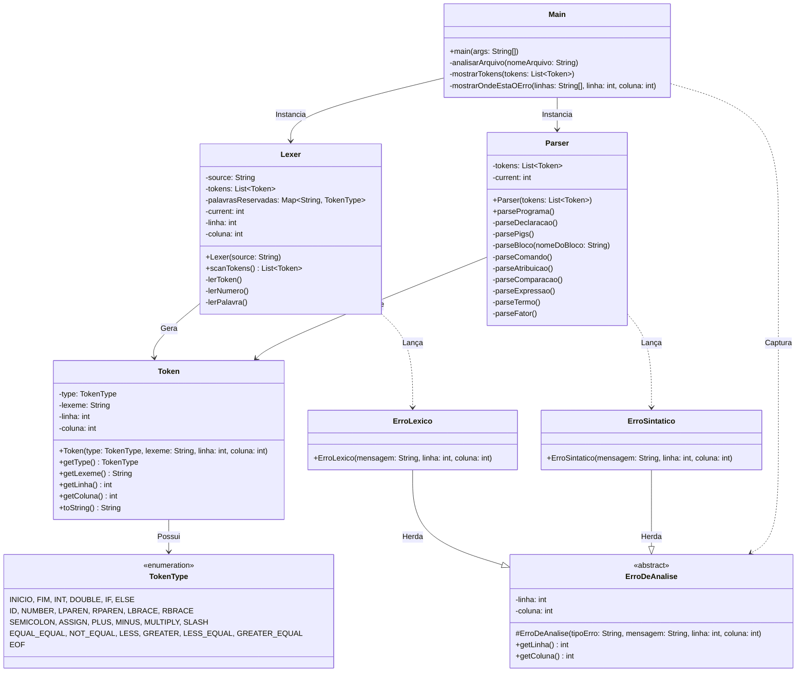

# Documentação Técnica: Componentes do Analisador MiniLang

Esta documentação detalha a arquitetura interna, as classes e as responsabilidades dos componentes que formam o analisador léxico e sintático da linguagem MiniLang.

## Diagrama de Classes (UML)

O diagrama abaixo ilustra a relação e o fluxo de dados entre os componentes do sistema.

---

## Detalhamento dos Componentes

### 1. `Main` (Classe Principal)
Ponto de entrada da aplicação. Orquestra o fluxo de execução lendo o código-fonte e acionando as fases de análise.
*   **Responsabilidades:**
    *   Ler o arquivo de texto contendo o código-fonte (ex: `codigo.txt`).
    *   Tratar problemas de codificação, como o caractere BOM (0xFEFF) e padronizar quebras de linha (`\n`).
    *   Instanciar o `Lexer` para gerar os tokens.
    *   Instanciar o `Parser` para validar a sintaxe baseada nos tokens gerados.
    *   Capturar exceções do tipo `ErroDeAnalise` e formatar a saída de erro, exibindo visualmente no console onde a falha ocorreu usando um indicador (`^`).

### 2. `Lexer` (Analisador Léxico)
Responsável por transformar a string bruta do código-fonte em uma sequência de objetos interpretáveis (`Tokens`).
*   **Responsabilidades:**
    *   Percorrer o código caractere por caractere.
    *   Ignorar espaços em branco e comentários de linha (`//`).
    *   Identificar números inteiros e decimais (ex: `1500.50`), barrando formatações inválidas.
    *   Identificar identificadores de variáveis e palavras reservadas mapeadas (usando o `Map` `palavrasReservadas`).
    *   Gerenciar o estado da posição atual (linha e coluna) para emitir mensagens de erro precisas caso encontre caracteres não reconhecidos.

### 3. `Parser` (Analisador Sintático)
Implementa um *Recursive Descent Parser* (Analisador Descendente Recursivo). Avalia se a sequência de tokens obedece à gramática da linguagem.
*   **Responsabilidades:**
    *   Validar a estrutura geral (deve iniciar com `startfarm`, conter variáveis, um condicional e terminar com `endfarm`).
    *   Implementar a precedência de operadores matemáticos dividindo a lógica em `parseExpressao` (`+`, `-`), `parseTermo` (`*`, `/`) e `parseFator` (números, variáveis, parênteses e negação).
    *   Garantir a verificação de regras de negócio sintáticas (ex: não permitir blocos aninhados indevidos, como um `if` dentro de outro `if`).
    *   Lançar `ErroSintatico` detalhado quando a ordem dos tokens for inesperada.

### 4. `Token` (Entidade de Dados)
Estrutura imutável que carrega as propriedades de um agrupamento léxico.
*   **Atributos principais:**
    *   `type`: Categoria do token (ex: `ID`, `NUMBER`, `PLUS`).
    *   `lexeme`: O texto exato capturado do arquivo (ex: `idade`, `17`, `+`).
    *   `linha` e `coluna`: Coordenadas de onde o token se iniciou, vitais para o relatório de erros.

### 5. `TokenType` (Enumeração)
Dicionário de todos os símbolos válidos na MiniLang.
*   **Categorias:**
    *   *Palavras-chave:* `INICIO` (`startfarm`), `FIM` (`endfarm`), `INT` (`sheep`), etc.
    *   *Literais:* `ID`, `NUMBER`.
    *   *Pontuação e Operadores:* `LPAREN`, `ASSIGN`, `PLUS`, `EQUAL_EQUAL`, etc.
    *   *Controle:* `EOF` (End of File).

### 6. Sistema de Tratamento de Erros
*   **`ErroDeAnalise` (Classe Abstrata):** Estende `RuntimeException`. Centraliza os atributos de `linha` e `coluna` e a formatação básica da mensagem, permitindo que a `Main` capture qualquer erro de compilação em um único bloco `catch`.
*   **`ErroLexico`:** Lançado pelo `Lexer` quando um caractere desconhecido é lido (ex: `1idade` começando com número, uso de acentos ou símbolos como `@`).
*   **`ErroSintatico`:** Lançado pelo `Parser` quando tokens válidos formam uma sentença inválida (ex: `x = + 1;` ou falta de ponto e vírgula).